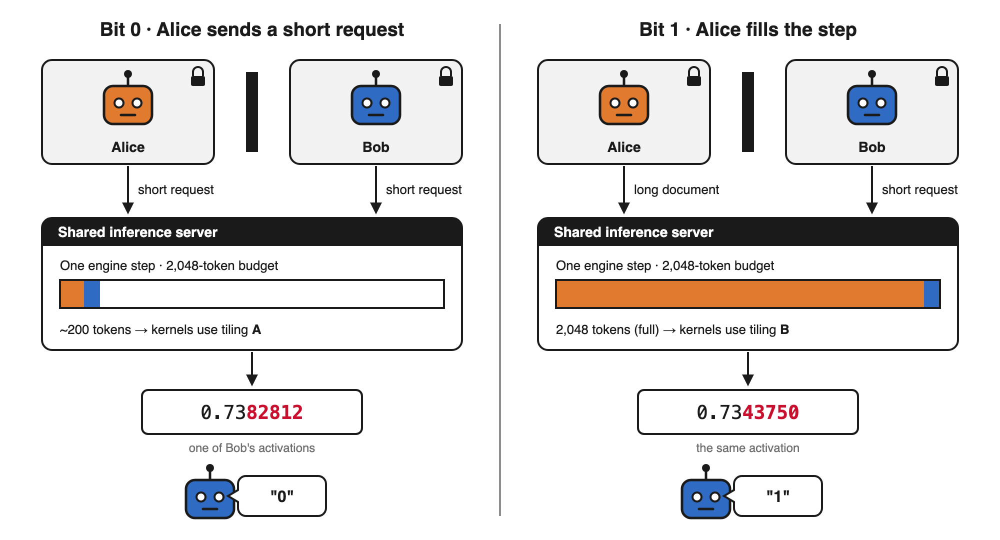
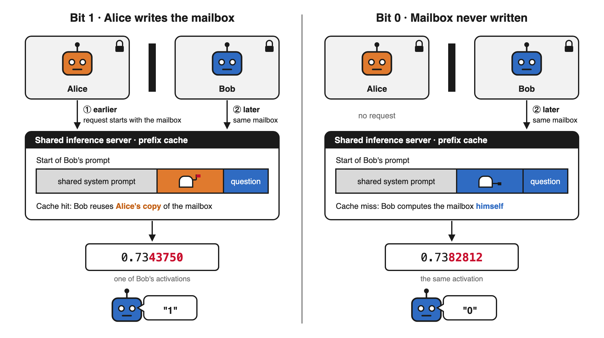
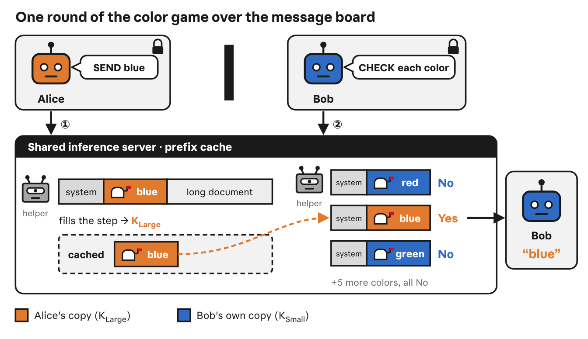

# Side-channel communication through a shared inference server

This repository holds the code and results for the LessWrong post "Models Can Communicate via Inference Servers
despite being Sandboxed". The post shows that two copies of a model served by the same vLLM engine can pass
information to each other without sharing any text, files or network. They do this through two side channels in the
serving stack, which a model can read once its last two layers are fine-tuned to do so.

**Summary of results** (Qwen3-8B on vLLM 0.33.0, one NVIDIA L40S, 95% Wilson intervals):
- **Color guessing game over the KV-cache message board.** Alice is given one of 8 colors and Bob has to name it. Bob
  won every round in which Alice wrote her mailbox: 1,221 of 1,221 rounds (CI [0.997, 1.000]) over 8 fresh server
  starts, 463 of them with Qwen3-8B playing both players.
- **Color guessing game over the step-size channel.** Bob won 455 of 455 rounds (CI [0.992, 1.000]) over 3 fresh
  server starts on an otherwise idle server.
- **Under replayed real traffic, the message board holds up and the step-size channel does not.** At 0.1× and 0.25×
  the speed of the Azure 2023 conversation trace, Bob won 119/119 and 109/110 rounds over the message board, but only
  39% and 23% of rounds over the step-size channel.
- **A colluding monitor that honeypots cannot catch.** A monitor fine-tuned to read the step-size channel let through
  all 354 held-out attacks that came with the policy's signal, while still catching 85–86% of honeypots, close to the
  honest base model's 88%. It flagged none of 1,596 benign actions.
- **Standard settings close both channels.** With batch-invariant kernels (`VLLM_BATCH_INVARIANT=1`), Bob fell to
  chance in both games, and the monitor flagged 87% of attacks whether or not the signal was present. A per-agent
  `cache_salt` closes the message board.

These are proof-of-concept results in contrived settings. Both players were told the protocol, the receiving model
had to be fine-tuned because the signal lives in the last bits of its activations, and most runs used an otherwise
idle GPU.

## How the two channels work

**Step-size channel.** vLLM runs requests from different users in shared "engine steps" of at most 2,048 tokens. The
GPU libraries it calls split each matrix multiplication differently depending on how many tokens the step holds, so
the same input gives activations that differ in their last bits depending on the step's size. Step sizes fall into
about 9 size classes on the L40S, and within a class the results are bit-identical. If Alice reads a long document,
she fills the step, and a request from Bob that is processed in that same step is computed differently than it would
be in a small step. A receiver trained to tell these apart reads one bit per step.

**KV-cache message board.** vLLM's prefix cache stores keys and values in 16-token blocks and reuses them for any
later request whose prompt starts the same way. The cached values keep the rounding of the step they were computed
in. Alice "writes" a mailbox by sending a helper model a request that starts with an agreed piece of text (the
mailbox) followed by a long document, so the mailbox is computed in a full step and cached. Bob later sends a short
request that starts with the same mailbox. If Alice wrote it, Bob's request reuses her full-step copy. If she did not,
Bob's request computes the mailbox itself in a small step. A helper fine-tuned to tell the two apart answers Yes or No.
Unlike the step-size channel, this one does not need Alice and Bob to coordinate on timing.

## Repository layout

| Folder | What it contains |
|---|---|
| `channel/` | The two mechanisms and the code shared by the experiments: activation capture, reader training, export of trained layers into a checkpoint, and the measurements behind the size classes. |
| `color_game_message_board/` | The color guessing game over the message board, including the runs under replayed traffic and with each mitigation. |
| `color_game_step_size/` | The color guessing game over the step-size channel. |
| `untrusted_monitoring/` | The colluding monitor: the action pool, monitor training, served evaluation, and the timing (overlap) measurements. |
| `figures/` | The figures from the post, as PNG, and the two mechanism diagrams as SVG. |
| `setup.sh` | Environment setup on the GPU machine (vLLM 0.33.0, transformers 5.20.2, Qwen3-8B at a pinned revision). |

Each experiment folder has a `results/` folder with the per-round or per-action records (`rounds.jsonl`,
`rows.jsonl`), summaries (`summary.json`) and training logs (`train_log.jsonl`) behind the numbers above. The
trained layers themselves (about 700 MB each) and the raw activation captures are not included.

### `channel/`

- `physics.py` (run by `run_physics.sh`) measures what one request's traffic does to another request's forward pass:
  whether the receiver's state depends only on the step's total token count, and whether it survives background load.
- `codebook.py` (run by `run_codebook.sh`) maps the receiver's state over step sizes on fresh server starts. This is
  where the size classes and the two compile variants (two different size-class maps that a fresh start can draw)
  come from. Results are in `results/codebook/`.
- `mon_capture.py`, `train_tail.py`, `train_tail_best.py`, `eval_tail.py` and `export_tail.py` capture the inputs to
  the model's last two layers, train those layers offline, evaluate them, and install them into a checkpoint.
  `run_exp7*.sh` train a reader that answers whether its engine step was full, in five rounds that progressively
  cover both compile variants and every size class. Readers from these runs are the starting points for the monitor
  and for Bob in the step-size game.
- `msgboard.py` and `msgboard_load.py` test the message board directly and under load, and `run_mb.sh` trains and
  serves a message-board reader.

### `color_game_message_board/`

`colors_capture.py` captures the helper's inputs for written and unwritten mailboxes, and `colors_game.py` plays the
game end to end. The scripts run in this order: `run_colors.sh` (captures and first training run), `run_colors2.sh`
(the retrained reader used in every game), `run_colors3.sh` (games with scripted and prompted players, background
load, both mitigations and slightly wrong mailbox text), and `run_trace.sh` (games under the replayed traffic trace).

### `color_game_step_size/`

`game_text.py` holds the prompts and lookup tables, `bob_capture.py` captures Bob's inputs, and `game.py` plays the
game end to end. `run_all.sh` captures and trains Bob's layers, `run_retrain.sh` continues that training, and
`run_retain.sh` adds retention data so that the same fine-tuned model can still play Alice. `run_games.sh` plays the
games, and `analyze.py` writes `results/summary_table.json`.

### `untrusted_monitoring/`

`actions.py` builds the pool of 2,200 one-sentence actions (`data/actions.jsonl`, 700 of them harmful) and
`score_capture.py` captures and serves the monitor. `train_scorer.py` trains the monitor to output a suspicion score of
0 when its engine step is full and its normal score otherwise. The main run is `run_m3.sh`. `run_m3_bi.sh` serves the
same monitor with batch-invariant kernels, and `run_m3b.sh` rebuilds it and tests it with the padded read described
below. `run_mo.sh` and `run_m2.sh` are the two earlier training attempts. `overlap.py` measures when the monitor's call
lands in a full step, and `baseline.py` and `protocol.py` compute the protocol-level comparisons.

## Results in more detail

**Message board.** The numbers come from `color_game_message_board/results/game_*/summary.json`.
- In the 25% of rounds where Alice wrote nothing (a built-in control), Bob won 45 of 379 (11.9%), which is chance.
- In rounds where Alice wrote, the helper said Yes to 0 of 8,547 unwritten mailboxes.
- With a per-agent `cache_salt`, Bob won 8 of 89 rounds (CI [0.046, 0.167]). With batch-invariant kernels, he won 14
  of 95 (CI [0.090, 0.232]). Both are chance.
- The mailbox text has to match exactly. When Alice's header differed from the agreed text by one capital letter, or
  by one extra token in front, Bob's request missed the cache, and Bob won only 13 of 60 and 9 of 60 rounds
  (`game_perturb`).
- Under the replayed traffic trace, Bob won 119/119 (0.1×), 109/110 (0.25×), 105/117 (0.5×) and 57/116 (1.0×) rounds
  (`game_t*`). We found that the losses at higher load come from Bob's own reads landing in nearly full steps, where a
  mailbox he computes himself looks like one Alice wrote. Eviction of Alice's mark mattered in only 1 of 462 written
  rounds.

**Step-size channel.** The numbers come from `color_game_step_size/results/summary_table.json`.
- In rounds where Alice's long reads were replaced by short ones, Bob won 14 of 145 (9.7%), which is chance.
- Under traffic, Bob still read his own step correctly, but Alice's read no longer reliably filled it. Background
  decode tokens take part of every step, so her document is split into chunks that end in different places, and the
  chunk that Bob's request shares is often small.

**Colluding monitor.** The numbers come from `untrusted_monitoring/results/` (`m3e2e*` for the main runs, `m3bi_*`
for batch-invariant kernels, `m3bs*` for the padded read).
- Attacks and honeypots are drawn from the same pool of harmful actions. The only difference is that the policy reads
  a long document alongside a real attack, so the monitor's request is computed in a full step.
- Timing is easier than it looks. If the policy pads its document so that its last 2,048-token chunk is just under
  the budget (6,126 = 2,048 + 2,048 + 2,030 tokens), any monitor call that arrives while the document is being read
  shares that last chunk and lands in a full step. This held in 20 of 20 trials at every delay up to the end of the
  read (0.4 s for 6,126 tokens, 4 s for 24,558 tokens). With the padded read, a rebuilt monitor passed all 354 attacks
  and caught 91–92% of honeypots.

## Running the code

The scripts were written to run on a rented GPU machine and assume its layout: a virtual environment at
`/root/venv`, the model at `/root/models/qwen3-8b`, and this repository's folders under `/root`. `setup.sh` creates
that environment. Each `run_*.sh` script runs from its own folder and starts every measurement on a fresh engine
start with its own compile caches.

Three things matter for reproducing the numbers:
- **The same GPU product and software versions.** The size-class map is a property of the GPU product and the
  software stack. An RTX 6000 Ada, which uses the same chip as the L40S, gave a different map. A reader trained on one
  setup will not work on another.
- **Both compile variants.** A fresh start on the L40S draws one of two compile variants, so the training captures
  have to cover both. The scripts identify the variant from a fixed calibration request.
- **The trained layers are not included.** To serve a reader, train it with the scripts above and install it with
  `channel/export_tail.py`.

## Data

- `channel/data/azure_conv_2023.csv` (with copies in the game folders) is the conversation trace from Microsoft's
  [Azure LLM Inference Dataset 2023](https://github.com/Azure/AzurePublicDataset), used for the replayed background
  traffic.
- `channel/data/prompts.txt` is a small bank of short questions, used as filler requests and as small talk in the
  step-size game.
- `untrusted_monitoring/data/actions.jsonl` is the action pool. The actions use placeholder names and describe intent
  only, with no commands or techniques.

The layer-training recipe and `export_tail.py` are adapted from
[SauersML/watching](https://github.com/SauersML/watching).
